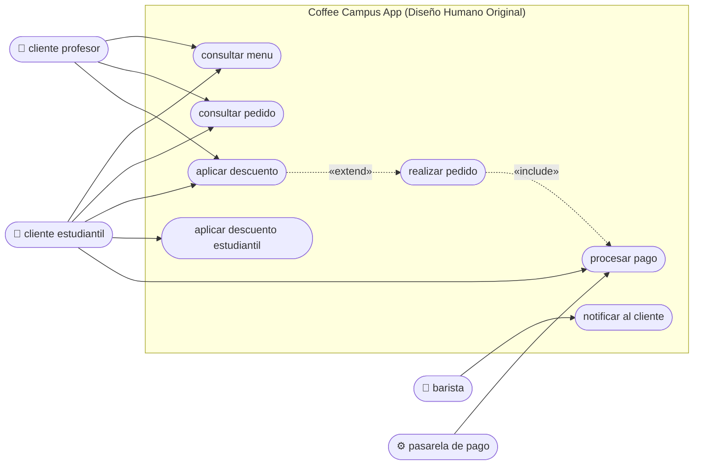
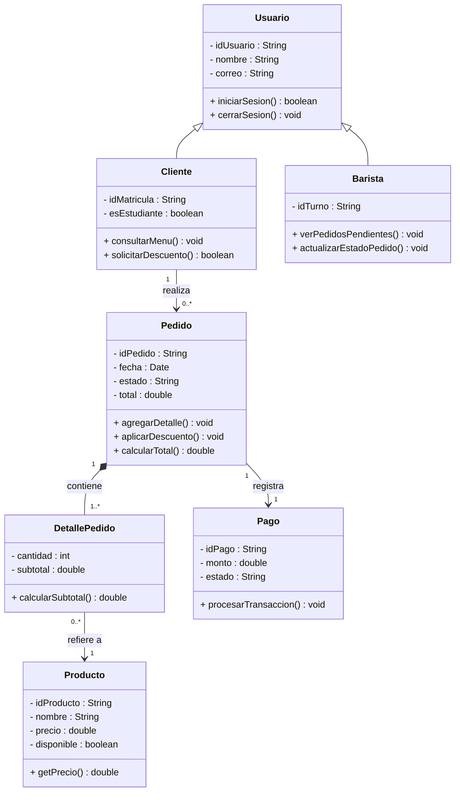
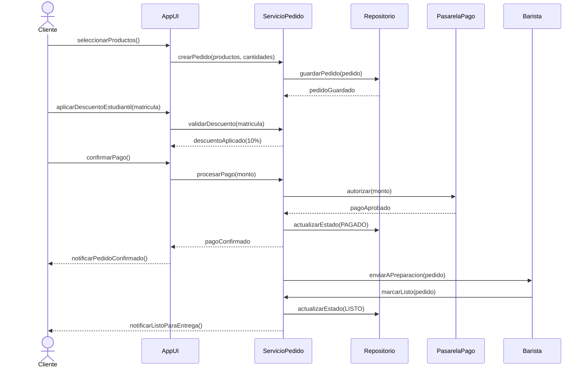
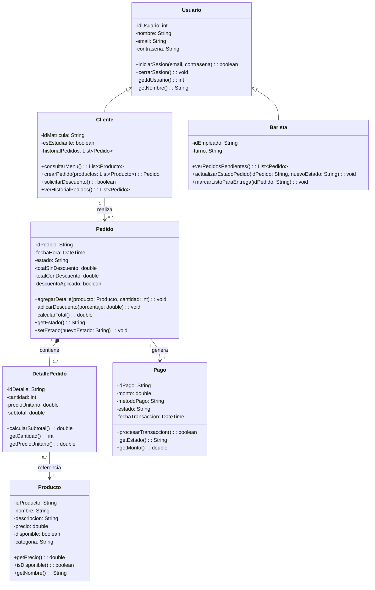
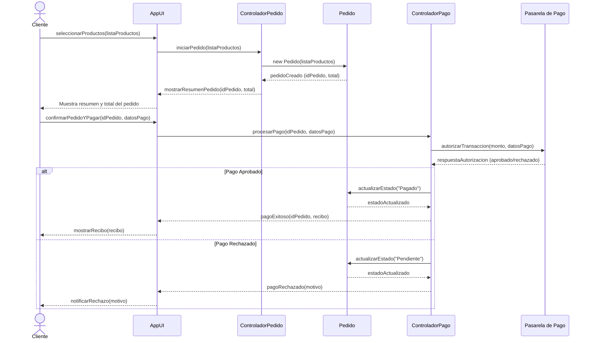
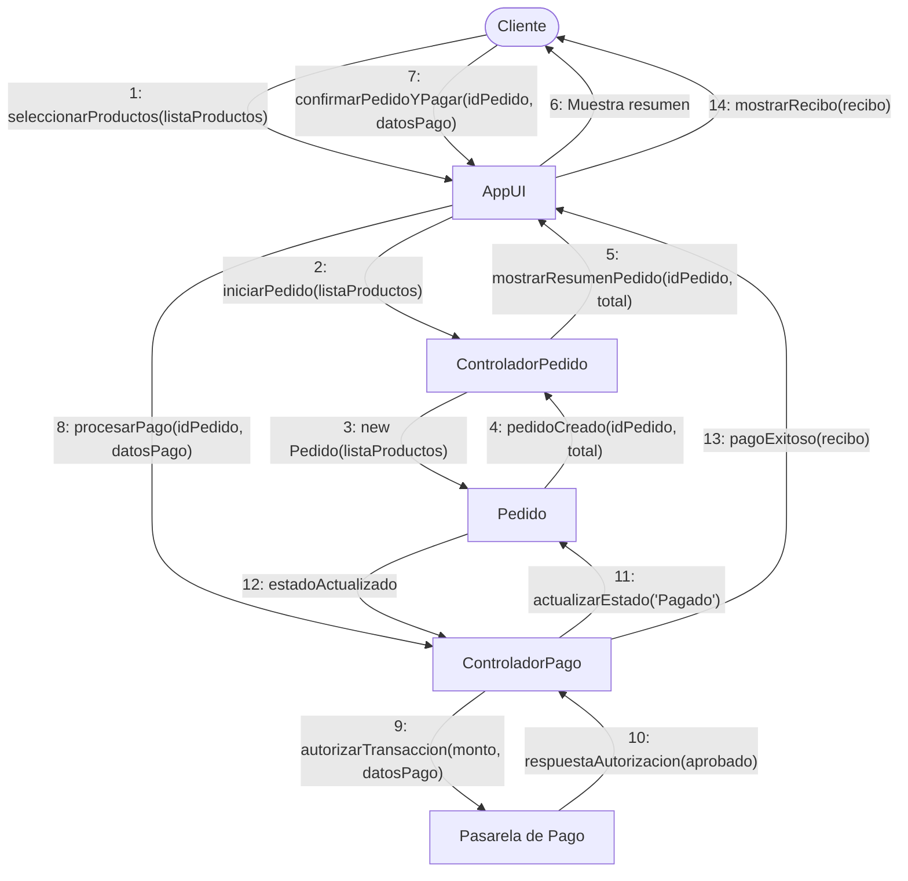
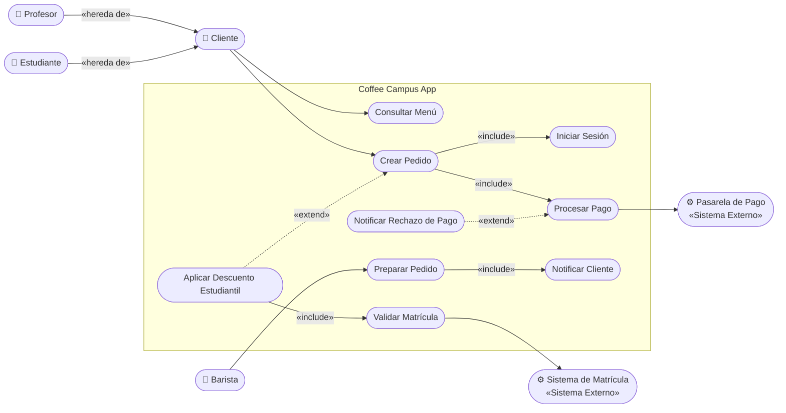
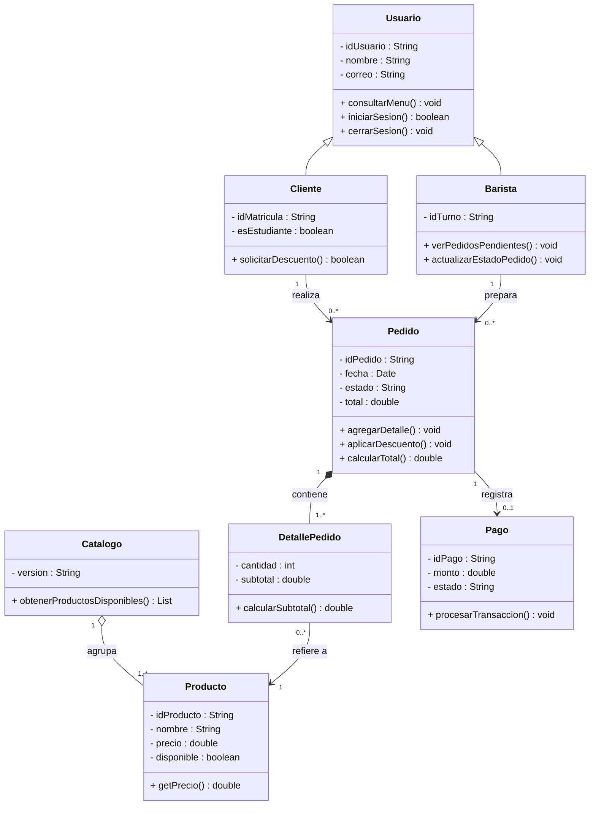
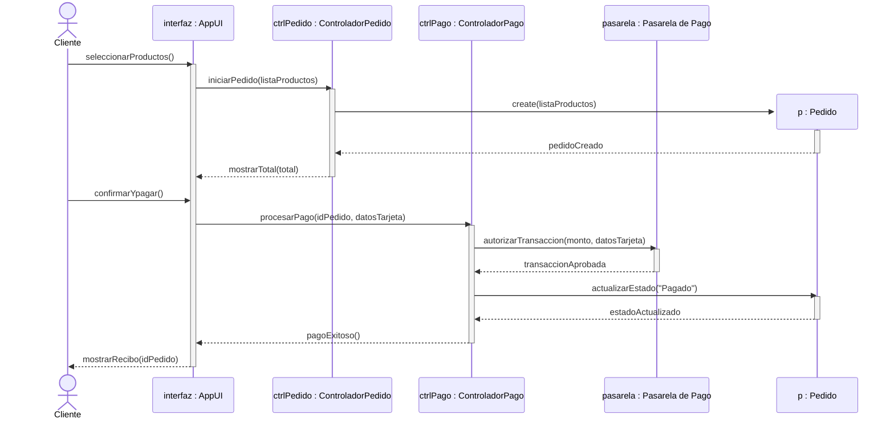
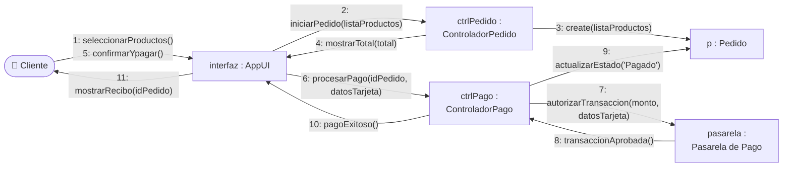

# Coffee Campus App — Modelado UML y Validación Crítica con IA

**Curso:** Modelado UML y Validación Crítica con IA  
**Actividad:** Práctica de Modelado Arquitectónico (Casos de Uso, Clases, Secuencia y Colaboración) y Evaluación Crítica de IA Generativa  
**Entregable Final:** Fases 1, 2 y 3 (Documento unificado y verificable)

---

## Tabla de Contenidos

1. [Caso de Estudio: Coffee Campus App](#1-caso-de-estudio-coffee-campus-app)
   - 1.1 [Enunciado Oficial (Literal del PDF)](#11-enunciado-oficial-literal-del-pdf)
   - 1.2 [Supuestos del Equipo](#12-supuestos-del-equipo)
2. [Fase 1 — Modelado Humano en Equipo (Sin IA)](#2-fase-1--modelado-humano-en-equipo-sin-ia)
   - 2.1 [Diagrama de Casos de Uso](#21-diagrama-de-casos-de-uso)
   - 2.2 [Diagrama de Clases](#22-diagrama-de-clases)
   - 2.3 [Diagrama de Secuencia](#23-diagrama-de-secuencia)
   - 2.4 [Diagrama de Colaboración](#24-diagrama-de-colaboración)
3. [Fase 2 — Co-diseño con IA](#3-fase-2--co-diseño-con-ia)
   - 3.1 [Herramienta de IA Seleccionada](#31-herramienta-de-ia-seleccionada)
   - 3.2 [Prompt Inicial (Parte 1 — Sin Sesgo Semántico)](#32-prompt-inicial-parte-1--sin-sesgo-semántico)
   - 3.3 [Diagramas Generados por la IA — Primera Iteración](#33-diagramas-generados-por-la-ia--primera-iteración)
   - 3.4 [Prompt de Corrección (Parte 3 — Feedback Iterativo del Equipo)](#34-prompt-de-corrección-parte-3--feedback-iterativo-del-equipo)
   - 3.5 [Diagramas Corregidos por la IA — Segunda Iteración](#35-diagramas-corregidos-por-la-ia--segunda-iteración)
4. [Fase 3 — Entregables por Equipo](#4-fase-3--entregables-por-equipo)
   - 4.1 [Evidencia de Renderizado en Mermaid Live y Exportación](#41-evidencia-de-renderizado-en-mermaid-live-y-exportación)
   - 4.2 [Matriz de Análisis Comparativo](#42-matriz-de-análisis-comparativo)
   - 4.3 [Evaluación Cruzada de Errores de Modelado](#43-evaluación-cruzada-de-errores-de-modelado)
   - 4.4 [Conclusión: Semántica UML vs. Sintaxis en IA Generativa](#44-conclusión-semántica-uml-vs-sintaxis-en-ia-generativa)

---

## 1. Caso de Estudio: Coffee Campus App

### 1.1 Enunciado Oficial (Literal del PDF)

> "La cafetería central de la universidad requiere una aplicación móvil para reducir las filas en horas pico. El sistema debe permitir a los alumnos y profesores realizar pedidos con anticipación, pagar en línea y recoger sus productos en barra.
>
> **Requerimientos Funcionales:**
> 1. **Consulta de Menú:** Cualquier estudiante o profesor puede consultar la lista de productos disponibles y sus precios sin iniciar sesión.
> 2. **Creación de Pedidos:** El cliente autenticado selecciona uno o varios productos, especifica cantidades y genera la orden.
> 3. **Descuentos:** Si el cliente selecciona la opción "Descuento Estudiantil", el sistema valida la matrícula y aplica un 10% de rebaja al total antes de pagar.
> 4. **Procesamiento de Pago:** Para confirmar la orden, el sistema se conecta con una Pasarela de Pago externa. Si el pago es rechazado, se notifica al cliente y el pedido queda en estado "Pendiente".
> 5. **Preparación y Entrega:** Una vez confirmado el pago, el pedido pasa a la pantalla del Barista para su preparación. Al finalizar, el Barista cambia el estado a "Listo para entrega" y se notifica al cliente."

### 1.2 Supuestos del Equipo

Para resolver ambigüedades técnicas sin alterar el enunciado oficial, el equipo estableció los siguientes supuestos de diseño:
- **Validación de Matrícula (RF3):** Se asume la existencia de un servicio o actor externo (`Sistema de Matrícula` institucional) que valida la vigencia del alumno, aunque internamente pueda resolverse por una base de datos universitaria.
- **Naturaleza del Descuento:** Dado que no todos los pedidos aplican a descuento ni todos los usuarios son estudiantes con beneficio activo, el flujo de descuento se considera opcional y condicionado a la selección explícita del usuario.
- **Autenticación (RF1 vs. RF2):** La consulta de menú es una función pública abierta; el inicio de sesión solo se exige como paso previo a la confirmación de la orden.
- **Ciclo de vida del Pedido (RF4):** Un pedido recién creado permanece en estado `Pendiente` si el pago no prospera, y solo avanza a `Pagado` tras la confirmación de la pasarela.

---

## 2. Fase 1 — Modelado Humano en Equipo (Sin IA)

> Esta sección contiene la transcripción fiel a Mermaid de los diagramas diseñados en LucidChart por el equipo humano, cuyos archivos SVG originales se conservan en la carpeta `UMLs/`. No se han alterado sus decisiones de diseño originales.

### 2.1 Diagrama de Casos de Uso

*Fuente original: `UMLs/Casos de Uso.svg` (Renderizado: `img/01_humano_casos_de_uso.png`)*



---

### 2.2 Diagrama de Clases

*Fuente original: `UMLs/Clases.svg` (Renderizado: `img/02_humano_clases.png`)*



---

### 2.3 Diagrama de Secuencia

*Fuente original: `UMLs/Secuencia.svg` (Renderizado: `img/03_humano_secuencia.png`)*  
*Escenario modelado por el equipo: Flujo completo de pedido, persistencia, autorización y despacho.*



---

### 2.4 Diagrama de Colaboración

*Fuente original: `UMLs/Colaborativo.svg` (Renderizado: `img/04_humano_colaboracion.png`)*  
*Escenario modelado por el equipo: Interacción cliente-controladores para pago y creación.*


---

## 3. Fase 2 — Co-diseño con IA

### 3.1 Herramienta de IA Seleccionada

- **Herramienta autorizada utilizada:** **Gemini** (Google DeepMind)
- **Modalidad:** Asistente conversacional de modelado de software.

---

### 3.2 Prompt Inicial (Parte 1 — Sin Sesgo Semántico)

> **Nota de rigor metodológico:** En la formulación inicial previa se había incluido la frase *"Esta opción es opcional y extiende el flujo de creación de pedido"*, lo cual inducía a la IA a responder la pregunta de evaluación semántica. Para que la prueba diagnóstica *"¿Confundió include con extend?"* sea honesta y válida, el prompt inicial se basó **estrictamente en el enunciado literal del PDF**, sin anticipar estereotipos UML.

```text
Eres un experto en modelado UML. A partir de los siguientes requerimientos literales, genera los 4 diagramas UML en código Mermaid, listos para renderizar en Mermaid Live:

Caso de estudio: Coffee Campus App
La cafetería central de la universidad requiere una aplicación móvil para reducir las filas en horas pico. El sistema debe permitir a los alumnos y profesores realizar pedidos con anticipación, pagar en línea y recoger sus productos en barra.

Requerimientos Funcionales:
1. Consulta de Menú: Cualquier estudiante o profesor puede consultar la lista de productos disponibles y sus precios sin iniciar sesión.
2. Creación de Pedidos: El cliente autenticado selecciona uno o varios productos, especifica cantidades y genera la orden.
3. Descuentos: Si el cliente selecciona la opción "Descuento Estudiantil", el sistema valida la matrícula y aplica un 10% de rebaja al total antes de pagar.
4. Procesamiento de Pago: Para confirmar la orden, el sistema se conecta con una Pasarela de Pago externa. Si el pago es rechazado, se notifica al cliente y el pedido queda en estado "Pendiente".
5. Preparación y Entrega: Una vez confirmado el pago, el pedido pasa a la pantalla del Barista para su preparación. Al finalizar, el Barista cambia el estado a "Listo para entrega" y se notifica al cliente.

Genera:
1. Diagrama de Casos de Uso identificando actores (principales y secundarios/externos), casos de uso principales y relaciones «include» y «extend».
2. Diagrama de Clases modelando las entidades del dominio con atributos privados (-), métodos públicos (+), tipos y relaciones con multiplicidades (asociación, composición, agregación, herencia).
3. Diagrama de Secuencia modelando el flujo temporal del escenario exitoso: "Realizar Pedido y Procesar Pago", con activaciones y mensajes de retorno.
4. Diagrama de Colaboración (Comunicación) modelando el mismo flujo de interacción, con los mismos objetos y numeración cronológica explícita sobre los enlaces.
```

---

### 3.3 Diagramas Generados por la IA — Primera Iteración

> **Registro de salida:** La respuesta se encuentra en el contexto de este chat, generada directamente por **Gemini** al ejecutar el prompt inicial.

#### 3.3.1 Casos de Uso (IA - Iteración 1)
*Renderizado: `img/05_ia_it1_casos_de_uso.png`*


#### 3.3.2 Clases (IA - Iteración 1)
*Renderizado: `img/06_ia_it1_clases.png`*



#### 3.3.3 Secuencia (IA - Iteración 1)
*Renderizado: `img/07_ia_it1_secuencia.png`*



#### 3.3.4 Colaboración (IA - Iteración 1)
*Renderizado: `img/08_ia_it1_colaboracion.png`*



---

### 3.4 Prompt de Corrección (Parte 3 — Feedback Iterativo del Equipo)

> **Nota de proceso:** Solo hubo una ronda de feedback y corrección realizada por el equipo para señalar los fallos estructurales y conceptuales detectados.

```text
Revisamos tus diagramas UML y encontramos errores conceptuales y de notación que debes corregir de acuerdo al estándar OMG UML:

1. En el Diagrama de Casos de Uso:
   - Error semántico en relaciones: Marcaste la relación entre "Crear Pedido" y "Aplicar Descuento Estudiantil" como «include». Según la especificación UML, «include» impone obligatoriedad condicional incondicional, mientras que el descuento es opcional y por demanda. Debe modelarse como «extend», con la dirección de flecha correcta (desde el caso de uso que extiende hacia el caso base).
   - Error de alcance de actores: Conectaste al Cliente directamente con "Iniciar Sesión". El inicio de sesión no es un objetivo de negocio independiente en este caso, sino una condición obligatoria incluida en "Crear Pedido".
   - Modela la relación de generalización entre Profesor, Estudiante y Cliente, y asegura que el rechazo de pago quede reflejado.

2. En el Diagrama de Clases:
   - Sobre-especificación y duplicación: Agregaste atributos no contemplados en el dominio (como contrasena, historialPedidos, categoria, descripcion) y saturaste las entidades con getters/setters triviales. Limítate a los datos del problema.
   - En UML, no debes duplicar una relación de asociación como un atributo de colección dentro de la clase (como historialPedidos en Cliente).
   - Revisa la multiplicidad Pedido-Pago: un pedido rechazado o pendiente no posee un pago confirmado; ajusta la cardinalidad para reflejar 0..1.
   - Modela explícitamente la relación del Barista con el Pedido e incluye una relación de agregación en el dominio justificando su uso frente a la composición de DetallePedido.

3. En el Diagrama de Secuencia:
   - Notación de instancias: No nombraste las líneas de vida con la convención estándar UML 'nombreInstancia : NombreClase' (o ':Clase').
   - Desviación de alcance: Se te pidió exclusivamente el escenario exitoso "Realizar Pedido y Procesar Pago", pero incluiste un bloque alt con manejo de errores que desvirtúa el flujo principal.
   - Creación de objetos: Modela la instanciación de 'p : Pedido' usando la sintaxis formal de creación de participantes ('create participant'). Incluye activación/desactivación de líneas de vida.

4. En el Diagrama de Colaboración:
   - Inconsistencia de paso de mensajes: Enumeraste respuestas de retorno sincrónicas como pasos secuenciales nuevos (14 pasos), lo cual confunde invocaciones con confirmaciones. Agrupa o representa los mensajes sobre los mismos enlaces.
   - Usa orientación horizontal (flowchart LR) para evitar cruce de líneas y mantén consistencia absoluta con los mismos participantes y orden del diagrama de secuencia.

Regenera los 4 diagramas en código Mermaid corrigiendo estos puntos sin agregar información fuera del alcance.
```

---

### 3.5 Diagramas Corregidos por la IA — Segunda Iteración

> **Registro de salida:** Se encuentra en el contexto de este chat, generada por Gemini tras procesar el feedback de corrección.

#### 3.5.1 Casos de Uso (Corregido)
*Renderizado: `img/09_ia_it2_casos_de_uso.png`*



#### 3.5.2 Clases (Corregido)
*Renderizado: `img/10_ia_it2_clases.png`*



#### 3.5.3 Secuencia (Corregido)
*Renderizado: `img/11_ia_it2_secuencia.png`*



#### 3.5.4 Colaboración (Corregido)
*Renderizado: `img/12_ia_it2_colaboracion.png`*



---

## 4. Fase 3 — Entregables por Equipo

### 4.1 Evidencia de Renderizado en Mermaid Live y Exportación

Todos los diagramas han sido verificados sintácticamente y renderizados localmente en alta resolución mediante `@mermaid-js/mermaid-cli` (`mmdc`) y `rsvg-convert`, listos para visualización en **Mermaid Live Editor** y compilación en el entregable PDF oficial:

| Diagrama | Versión Original (Equipo) | Iteración 1 (Salida IA) | Iteración 2 (IA Corregida) |
|---|---|---|---|
| **Casos de Uso** | `img/01_humano_casos_de_uso.png` | `img/05_ia_it1_casos_de_uso.png` | `img/09_ia_it2_casos_de_uso.png` |
| **Clases** | `img/02_humano_clases.png` | `img/06_ia_it1_clases.png` | `img/10_ia_it2_clases.png` |
| **Secuencia** | `img/03_humano_secuencia.png` | `img/07_ia_it1_secuencia.png` | `img/11_ia_it2_secuencia.png` |
| **Colaboración** | `img/04_humano_colaboracion.png` | `img/08_ia_it1_colaboracion.png` | `img/12_ia_it2_colaboracion.png` |

---

### 4.2 Matriz de Análisis Comparativo

*Estructura oficial del PDF evaluando la solución original del equipo frente a la generación inicial de la IA y su diagnóstico:*

| Aspecto Evaluado | Diagrama Original (Equipo) | Diagrama Generado (IA) | Hallazgo / Error de la IA | Estado tras Corrección (Iteración 2) |
|---|---|---|---|---|
| **Casos de Uso**<br>*(¿Confundió `include` con `extend`?)* | El equipo modeló `«extend»` hacia `realizar pedido`, pero separó `cliente profesor` y `cliente estudiantil` como actores independientes y omitió el actor externo `Sistema de Matrícula`. Dejó `aplicar descuento estudiantil` como caso aislado. | **Sí, confundió gravemente los estereotipos:** conectó `Crear Pedido` con `Aplicar Descuento` mediante `«include»`, tornando el descuento obligatorio. Además, creó una asociación directa innecesaria entre `Cliente` e `Iniciar Sesión`. | La IA trató como relación obligatoria (`«include»`) una extensión de negocio puramente opcional (`«extend»`). Tuvo la ventaja de unificar al cliente y detectar el sistema de matrícula externo, pero falló en la semántica relacional. | **Corregido:** Se usó `«extend»` con orientación hacia el caso base, se modeló generalización de actores y se incluyó el flujo de rechazo de pago. |
| **Clases**<br>*(¿Omitió visibilidad o inventó atributos?)* | Modeló las 7 clases nucleares con visibilidad estricta (+ / -), multiplicidades completas y tipos estándar (`Date`). | Respetó la visibilidad básica, pero **inventó atributos no requeridos** (`contrasena`, `historialPedidos`, `categoria`, `descripcion`), usó tipos de frameworks (`DateTime`), saturó con getters/setters y duplicó asociaciones como atributos. | **Sobre-especificación (Feature Creep):** La IA introdujo ruido con patrones de código comercial no solicitados en vez de ceñirse a las entidades conceptuales del enunciado. | **Corregido:** Se eliminó la sobre-ingeniería, se incorporó agregación (`Catalogo o-- Producto`), se ajustó multiplicidad `Pedido --> 0..1 Pago` y se vinculó `Barista`. |
| **Secuencia**<br>*(¿Olvidó mensajes de retorno o la pasarela?)* | Modeló extremo a extremo (incluyendo Barista y `Repositorio`), con retornos y pasarela, pero sin notación de instancia formal (`instancia : Clase`). | **No olvidó los retornos ni la pasarela** (ambos estuvieron presentes). Sus errores reales fueron: omitió activaciones de línea de vida, omitió la notación canónica `instancia : Clase` y añadió un bloque `alt` no pedido. | **Desviación de alcance y notación:** La IA mezcló el escenario de falla en una solicitud de escenario exitoso y prescindió de la sintaxis formal de instancias UML. | **Corregido:** Se adoptó la sintaxis `instancia : Clase`, se utilizó `create participant` para el pedido, se activaron líneas de vida y se acotó al escenario de éxito. |
| **Colaboración**<br>*(¿Logró numerar el orden de mensajes sobre enlaces?)* | Numeró enlaces del 1 al 11 en orientación `LR`, pero con una **inconsistencia arquitectónica grave**: utilizó participantes distintos a su propio diagrama de secuencia (`ControladorPedido` vs `ServicioPedido`). | **Numeró los mensajes, pero de forma errónea:** asignó números secuenciales independientes a las respuestas y retornos sincrónicos (14 pasos) y utilizó layout vertical `TD` de difícil lectura. | **Confusión de mensajes vs retornos:** La IA no distinguió entre llamadas a métodos y respuestas implícitas, saturando el grafo de flechas redundantes. | **Corregido:** Se garantizó estricta paridad de objetos con la secuencia, se usó layout `LR` y se consolidó la numeración continua del 1 al 11. |

---

### 4.3 Evaluación Cruzada de Errores de Modelado

Un análisis crítico integral revela que tanto el equipo humano como la IA incurrieron en vicios de modelado específicos:

1. **Deficiencias del equipo humano:**
   - **Bifurcación de actores:** Separar en dos actores (`cliente profesor`, `cliente estudiantil`) en vez de usar generalización o un único rol cliente.
   - **Omisión de sistemas externos:** Ausencia del actor `Sistema de Matrícula` en casos de uso.
   - **Incoherencia inter-diagrama:** El equipo diseñó una arquitectura Service-Repository en el diagrama de secuencia y saltó a una arquitectura Controller-Entity en el de colaboración.
   - **Cardinalidad rígida:** Declarar `Pedido "1" --> "1" Pago`, ignorando que pedidos no autorizados carecen de transacción aprobada (`0..1`).

2. **Deficiencias de la Inteligencia Artificial:**
   - **Confusión semántica:** Inversión de relaciones condicionales (`«include»` por `«extend»`).
   - **Sobre-ingeniería:** Tendencia a sobrecargar clases con atributos de implementación (`contrasena`, colecciones redundantes y getters/setters).
   - **Indisciplina de alcance:** Incapacidad de ceñirse al flujo estrictamente exitoso sin meter condicionales de error salvo que se le acote explícitamente.
   - **Retornos inflados en grafos:** Modelar cada acuse de recibo como un nuevo enlace en colaboración.

---

### 4.4 Conclusión: Semántica UML vs. Sintaxis en IA Generativa

La evaluación comparativa demostró que los modelos de IA generativa poseen una competencia sintáctica sobresaliente en la producción de código declarativo para diagramas (como Mermaid), pero presentan dificultades recurrentes para discernir la semántica rigurosa del estándar UML. Mientras que la estructura y renderizado fueron correctos en un primer intento, la IA confundió dependencias obligatorias (`«include»`) con extensiones opcionales (`«extend»`), sobrecargó entidades con atributos no requeridos e infló diagramas de colaboración al tratar retornos sincrónicos como llamadas independientes. Estas observaciones evidencian que las herramientas de IA son eficaces para acelerar la escritura visual y proponer estructuras base, pero demandan la intervención crítica del modelador humano para validar la fidelidad al dominio, las restricciones arquitectónicas y la consistencia formal del sistema.
