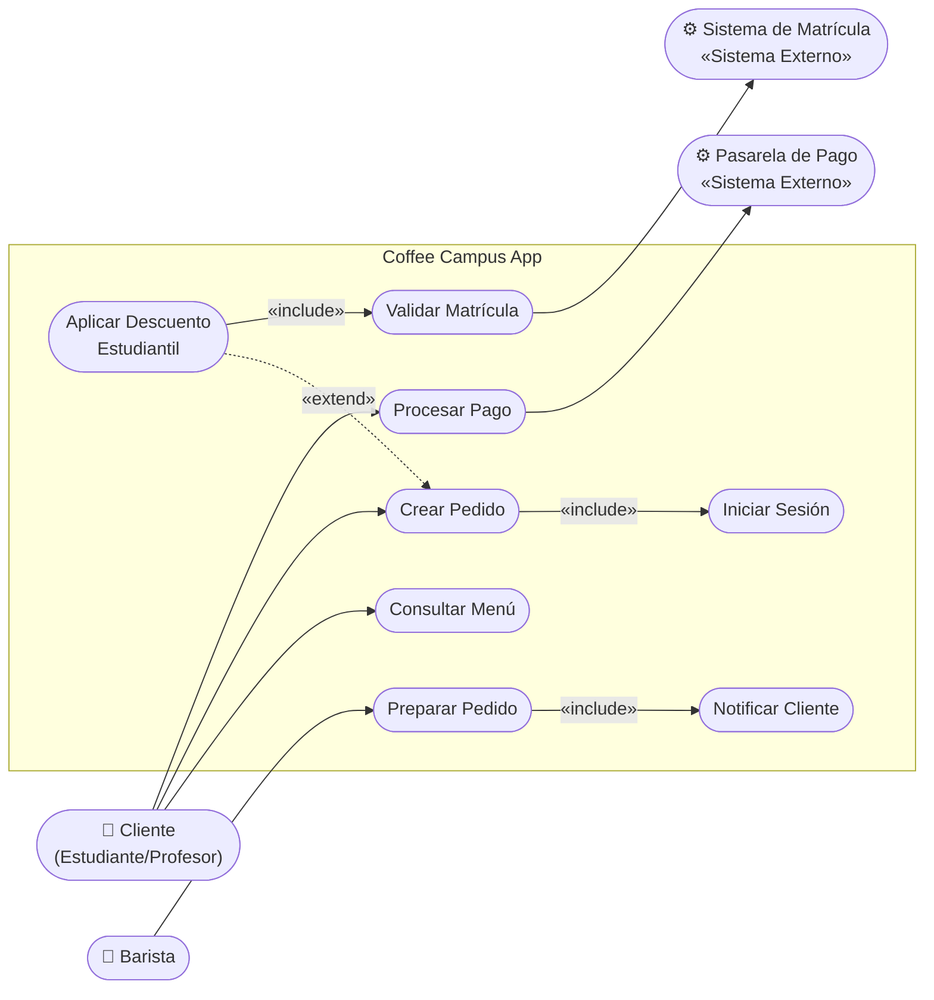
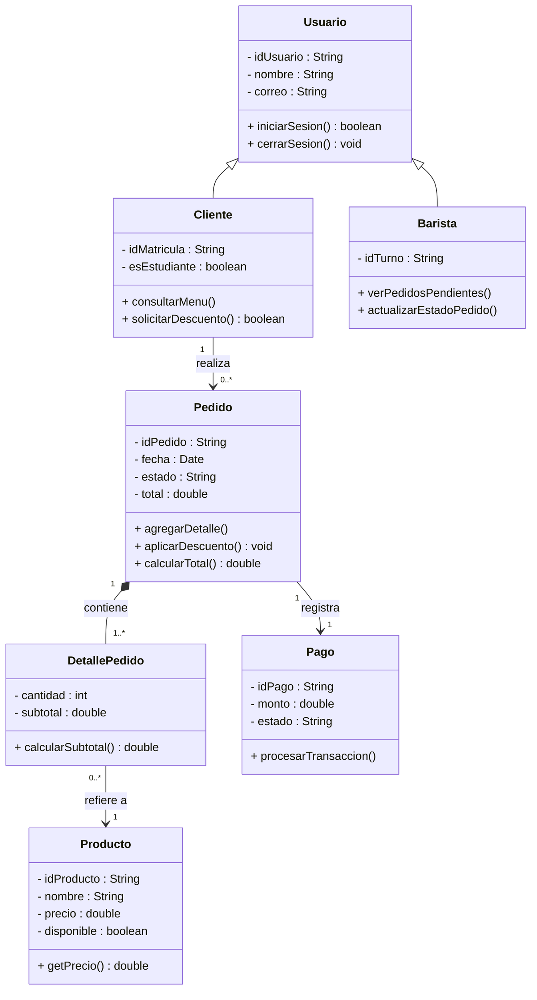
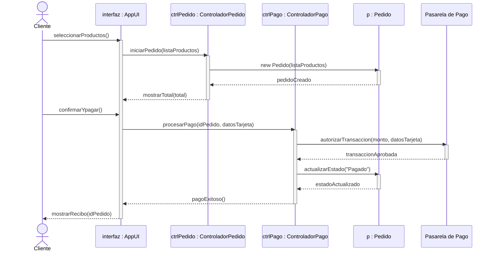
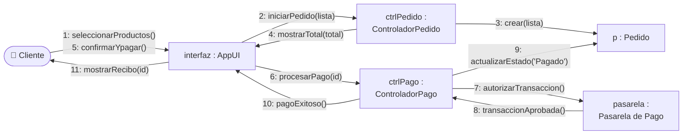
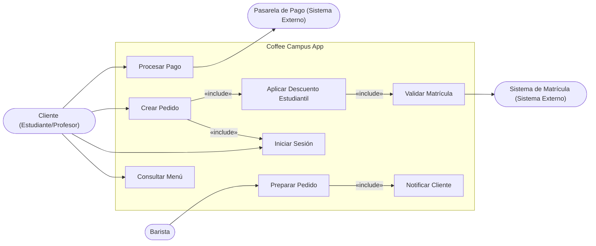
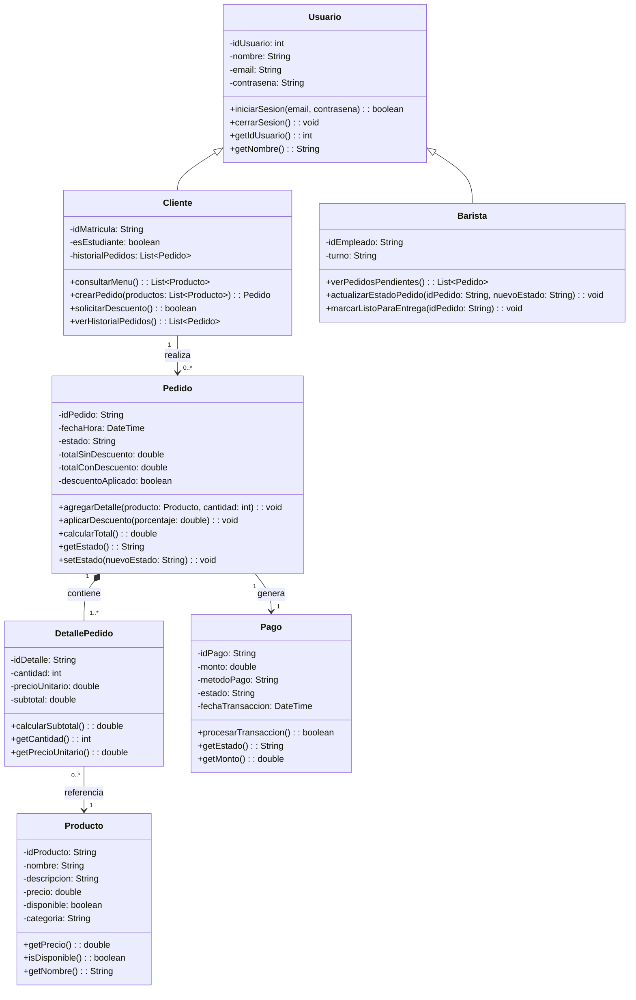
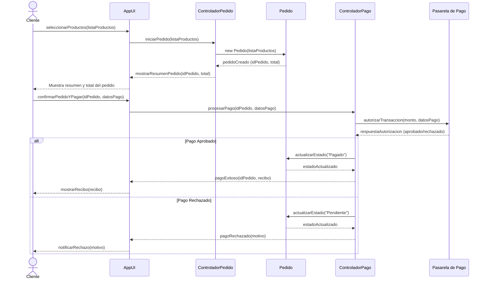

# Coffee Campus App — Actividad Formativa UML

**Curso:** Modelado UML y Validación Crítica con IA  
**Sistema:** Coffee Campus App — Aplicación móvil para la cafetería universitaria

---

## Tabla de Contenidos

1. [Caso de Estudio](#1-caso-de-estudio)
2. [Fase 1 — Diagramas UML del Equipo (Mermaid)](#2-fase-1--diagramas-uml-del-equipo-mermaid)
   - [Diagrama de Casos de Uso](#21-diagrama-de-casos-de-uso)
   - [Diagrama de Clases](#22-diagrama-de-clases)
   - [Diagrama de Secuencia](#23-diagrama-de-secuencia)
   - [Diagrama de Colaboración](#24-diagrama-de-colaboración)
3. [Fase 2 — Co-diseño con IA](#3-fase-2--co-diseño-con-ia)
   - [Prompt Inicial](#31-prompt-inicial)
   - [Diagramas Generados por la IA](#32-diagramas-generados-por-la-ia)
   - [Prompt de Corrección](#33-prompt-de-corrección)
   - [Matriz de Análisis Comparativo](#34-matriz-de-análisis-comparativo)
4. [Conclusión](#4-conclusión)

---

## 1. Caso de Estudio

La cafetería central de la universidad requiere una aplicación móvil para reducir las filas en horas pico. El sistema debe permitir a alumnos y profesores realizar pedidos con anticipación, pagar en línea y recoger sus productos en barra.

**Requerimientos Funcionales:**

| # | Requerimiento | Descripción |
|---|---------------|-------------|
| RF1 | Consulta de Menú | Cualquier estudiante o profesor puede consultar la lista de productos y precios **sin** iniciar sesión. |
| RF2 | Creación de Pedidos | El cliente autenticado selecciona productos, especifica cantidades y genera la orden. |
| RF3 | Descuentos | Al seleccionar "Descuento Estudiantil", el sistema valida la matrícula y aplica un 10 % de rebaja al total. |
| RF4 | Procesamiento de Pago | El sistema se conecta con una Pasarela de Pago externa. Si el pago es rechazado, se notifica al cliente y el pedido queda en estado "Pendiente". |
| RF5 | Preparación y Entrega | Una vez confirmado el pago, el pedido pasa a la pantalla del Barista. Al finalizar, el Barista cambia el estado a "Listo para entrega" y se notifica al cliente. |

---

## 2. Fase 1 — Diagramas UML del Equipo (Mermaid)

> Los diagramas fuente en PlantUML se encuentran en los archivos `.puml` de la raíz del repositorio.

### 2.1 Diagrama de Casos de Uso

**Actores identificados:**
- **Principales:** Cliente (Estudiante/Profesor), Barista
- **Secundarios / Sistemas externos:** Pasarela de Pago, Sistema de Matrícula

**Relaciones destacadas:**
- `«include»`: Crear Pedido incluye obligatoriamente Iniciar Sesión; Preparar Pedido incluye Notificar Cliente; Aplicar Descuento incluye Validar Matrícula.
- `«extend»`: Aplicar Descuento Estudiantil *extiende* Crear Pedido (es opcional, se activa sólo cuando el cliente lo solicita).

---

### 2.2 Diagrama de Clases

**Tipos de relaciones utilizadas:**
- **Herencia (`<|--`):** `Cliente` y `Barista` heredan de `Usuario`.
- **Composición (`*--`):** `Pedido` está compuesto de `DetallePedido` (el detalle no existe sin el pedido).
- **Asociación (`-->`):** `Cliente` realiza `Pedido`; `DetallePedido` refiere a `Producto`; `Pedido` registra un `Pago`.

---

### 2.3 Diagrama de Secuencia

**Escenario:** Realizar Pedido y Procesar Pago (flujo exitoso)

---

### 2.4 Diagrama de Colaboración

**Escenario:** Realizar Pedido y Procesar Pago

> Mermaid no posee soporte nativo para diagramas de comunicación/colaboración UML. Se representa mediante un diagrama de flujo con los mensajes numerados cronológicamente sobre los enlaces, respetando la semántica del diagrama de colaboración UML.

---

## 3. Fase 2 — Co-diseño con IA

### 3.1 Prompt Inicial

Se utilizó **Gemini** con el siguiente prompt:

---

> **Prompt inicial enviado a Gemini:**
>
> Eres un experto en modelado UML. A partir de los siguientes requerimientos, genera los 4 diagramas UML en código Mermaid, listos para renderizar en Mermaid Live:
>
> **Caso de estudio: Coffee Campus App**  
> La cafetería de una universidad necesita una app móvil. Los requerimientos son:
> 1. Cualquier usuario puede consultar el menú sin iniciar sesión.
> 2. El cliente autenticado puede crear pedidos seleccionando productos y cantidades.
> 3. Si el cliente elige "Descuento Estudiantil", el sistema valida su matrícula con un sistema externo y aplica un 10% de descuento. Esta opción es opcional y extiende el flujo de creación de pedido.
> 4. El pago se procesa a través de una Pasarela de Pago externa. Si es rechazado, el pedido queda en "Pendiente".
> 5. Al confirmar el pago, el Barista ve el pedido y cuando lo prepara cambia el estado a "Listo para entrega", notificando al cliente.
>
> Genera:
> 1. **Diagrama de Casos de Uso** con actores principales (Cliente, Barista) y sistemas externos (Pasarela de Pago, Sistema de Matrícula). Usa relaciones `«include»` y `«extend»` correctamente.
> 2. **Diagrama de Clases** con todas las entidades (Usuario, Cliente, Barista, Producto, Pedido, DetallePedido, Pago), sus atributos privados (-) y métodos públicos (+), y las relaciones con multiplicidades (herencia, composición, asociación).
> 3. **Diagrama de Secuencia** modelando el escenario exitoso "Realizar Pedido y Procesar Pago", con mensajes de retorno (líneas punteadas), activaciones y participación de la Pasarela de Pago.
> 4. **Diagrama de Colaboración** con los mismos objetos del diagrama de secuencia, numerando explícitamente el orden cronológico de cada mensaje sobre los enlaces.

---

### 3.2 Diagramas Generados por la IA

A continuación se presentan los diagramas tal como fueron generados por Gemini en su respuesta inicial.

#### Casos de Uso (generado por IA)

#### Diagrama de Clases (generado por IA)

#### Diagrama de Secuencia (generado por IA)

#### Diagrama de Colaboración (generado por IA)

---

### 3.3 Prompt de Corrección

Tras analizar los diagramas generados por la IA, se identificaron los errores descritos en la matriz (sección 3.4) y se envió el siguiente prompt de corrección:

---

> **Prompt de corrección enviado a Gemini:**
>
> Los diagramas que generaste tienen varios errores UML semánticos. Por favor corrígelos:
>
> **Error 1 — Casos de Uso:**  
> La relación entre "Crear Pedido" y "Aplicar Descuento Estudiantil" debe ser `«extend»`, NO `«include»`. El descuento es **opcional** y sólo se activa si el cliente lo solicita. Un `«include»` implica que siempre se ejecuta obligatoriamente. Corrige esto y elimina la asociación directa `Cliente --> UC2` porque el cliente no navega directamente a "Iniciar Sesión"; lo hace a través de "Crear Pedido" que lo incluye.
>
> **Error 2 — Diagrama de Clases:**  
> El diagrama está bien estructuralmente, pero añadiste atributos y métodos que no forman parte del modelo acordado (e.g., `historialPedidos`, `contrasena`, `descripcion`, `categoria`, `getters` innecesarios). Mantenlos al mínimo requerido por los requerimientos. Los atributos privados se marcan con `-` y los métodos públicos con `+`, como ya tenías.
>
> **Error 3 — Diagrama de Secuencia:**  
> El diagrama es aceptable pero debes asegurarte de que el nombre de los participantes use la notación UML de instancia: `nombreInstancia : NombreClase` (e.g., `interfaz : AppUI`, `ctrlPedido : ControladorPedido`). Esto los distingue de clases.
>
> **Error 4 — Diagrama de Colaboración:**  
> El diagrama usa orientación `TD` (top-down) en lugar de `LR`, lo que dificulta leer los enlaces. Más importante: los mensajes de retorno (respuestas) también deben estar numerados en el flujo cronológico. Los objetos intermedios no deben retornar mensajes de vuelta como flechas separadas cuando no aportan al flujo principal del escenario de éxito.

---

### 3.4 Matriz de Análisis Comparativo

| Aspecto Evaluado | Diagrama Original (Equipo) | Diagrama Generado (IA) | Hallazgo / Error de la IA |
|---|---|---|---|
| **Casos de Uso** | `«extend»` correcto: "Aplicar Descuento" extiende "Crear Pedido" de forma opcional. Cliente **no** apunta directamente a "Iniciar Sesión". | La IA usó `«include»` entre "Crear Pedido" y "Aplicar Descuento", haciendo el descuento **obligatorio**. Además añadió `Cliente --> IniciarSesión` como asociación directa. | **Error semántico grave:** confundió `«extend»` con `«include»`. No entendió que `«extend»` modela comportamiento opcional/condicional, mientras que `«include»` es obligatorio. |
| **Clases** | Atributos y métodos mínimos y precisos según los requerimientos. Visibilidad explícita (+ / -). Relaciones correctas con multiplicidades. | Incluyó atributos adicionales no requeridos (`contrasena`, `historialPedidos`, `categoria`, `descripcion`) y numerosos getters/setters que inflan el modelo. | **Error de sobre-especificación:** la IA "completó" el modelo más allá de los requerimientos dados, introduciendo ruido. Omitió el atributo `fecha: Date` del Pedido reemplazándolo por `fechaHora: DateTime`. |
| **Secuencia** | Participantes nombrados con notación de instancia UML (`interfaz : AppUI`). Mensajes de retorno (líneas punteadas) correctamente representados. Pasarela de Pago incluida. | Los participantes se nombraron sin notación de instancia (sólo el nombre de clase). El flujo de pago rechazado fue añadido sin que se pidiera. La Pasarela sí fue incluida. | **Error de notación:** omitió la nomenclatura de instancia UML. **Error de alcance:** modeló el flujo alternativo (pago rechazado) mezclado con el flujo exitoso solicitado, complicando innecesariamente el diagrama. |
| **Colaboración** | Flujo `LR`, mensajes numerados sobre los enlaces. Sólo mensajes relevantes al escenario exitoso. | Usó orientación `TD`. Numeró los mensajes de retorno como pasos separados (4, 6, 12, 14), desvirtuando el flujo del escenario principal. | **Error de estructura:** al numerar los mensajes de retorno como pasos independientes, el diagrama duplica acciones y confunde el conteo cronológico. En el diagrama de colaboración, los retornos se representan sobre el mismo enlace o se omiten si son implícitos. |

---

## 4. Conclusión

El ejercicio de co-diseño con IA evidenció que las herramientas de IA generativa como Gemini demuestran una comprensión sólida de la **sintaxis** de los lenguajes de modelado —produciendo código Mermaid válido y estructuralmente coherente— pero presentan limitaciones significativas en la **semántica UML**. El error más revelador fue la confusión sistemática entre `«include»` y `«extend»`: la IA trató como obligatorio un comportamiento que, por definición del requerimiento, es condicional y opcional. De igual forma, la tendencia a "completar" el modelo de clases con atributos y métodos no solicitados refleja que la IA optimiza para la exhaustividad sintáctica en lugar de la precisión conceptual del dominio. Esto confirma que la IA es una herramienta útil de apoyo para agilizar la notación, pero no puede reemplazar el juicio del modelador humano, quien entiende el **por qué** detrás de cada decisión de diseño, no sólo el **cómo** escribirla.
